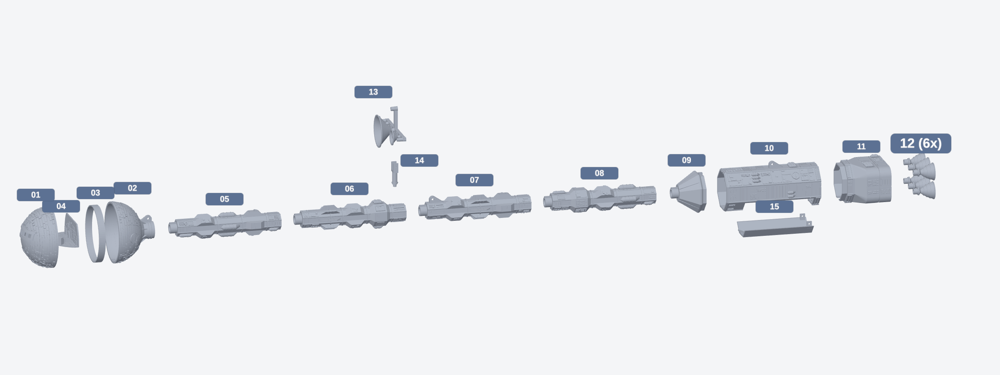

# Raumschiff-Modell mit LED-Beleuchtung (eigenes Design)

Eigenes Hard-SF-Raumschiff im Stil der klassischen "Wirbelsäulen"-Schiffe: kugelförmiges Crew-Modul mit Cockpit vorn,
lange Wirbelsäule mit Tankmodulen, bewegliche Antenne, Reaktorblock mit sechs Glockendüsen. Keine Kopie eines Filmmodells.
Das Modell wird **frei hängend** montiert; Akku, Elektronik und Schalter sitzen komplett im Schiff.


- Gesamtlänge 802 mm, Kugel 72 mm, 15 verschiedene Druckteile, das höchste 134 mm (für Anycubic Kobra Plus, 300 × 300 × 350 mm)
- Alle Teile liegen bereits in Druckausrichtung und brauchen **keine Stützstrukturen**
- `generate.py` erzeugt alle Dateien neu (`pip install manifold3d numpy`); Maße stehen oben im Skript

## Teile (Ordner `stl/`), nummeriert in Baureihenfolge von vorn nach hinten



| Datei | Teil | Höhe beim Druck | Hinweis |
|---|---|---|---|
| 01_crew_front | Crew-Kugel vordere Hälfte, Cockpit mit 5 Fenstern | 37 mm | Öffnung nach unten |
| 02_crew_rear | Crew-Kugel hintere Hälfte mit Hals und **Aufhängeöse** | 50 mm | Öffnung nach unten |
| 03_crew_joiner_ring | Verbindungsring mit Schlitz | 8 mm | |
| 04_cockpit_interior | Cockpit-Einsatz | 27 mm | Deck nach unten; 0,08 mm Schichthöhe |
| 05_spine_A | Wirbelsäule 1 (vorn) | 134 mm | stehend, Brim 8 mm, max. 30 mm/s |
| 06_spine_B_antenna | Wirbelsäule 2 mit Loch für den Antennenmast | 134 mm | stehend, Brim 8 mm, max. 30 mm/s |
| 07_spine_C_lug | Wirbelsäule 3 mit **Aufhängeöse** | 134 mm | stehend, Brim 8 mm, max. 30 mm/s |
| 08_spine_D | Wirbelsäule 4 (hinten) | 134 mm | stehend, Brim 8 mm, max. 30 mm/s |
| 09_adapter_collar | Übergang Wirbelsäule → Reaktorblock | 38 mm | breite Seite unten; **nur stecken, nicht kleben** (Zugang zum Akku) |
| 10_reactor_block | Reaktorblock: Rohr für Elektronik, Öffnung für die Akkuwanne, Schalterausschnitt, **Aufhängeöse** | 115 mm | Trennfläche nach unten |
| 11_engine_housing | Triebwerksgehäuse mit 6 Düsensockeln und Stecklippe | 57 mm | Heckfläche nach unten |
| 12_engine_nozzle_6x | Glockendüse mit LED-Sitz im Düsenhals | 25 mm | **6× drucken**, Rand unten, langsam |
| 13_antenna_dishes | Antennenträger mit 3 Schüsseln, Turm und LED-Sitzen | 24 mm | Schüsseln öffnen nach oben, langsam |
| 14_antenna_mast | Mast mit Gabel und Kabelkanal | 31 mm | kopfüber (Gabel unten), Brim 5 mm |
| 15_battery_tray | Akkuwanne: abnehmbare Unterseite des Reaktorblocks, trägt den Akkuhalter | 16 mm | flache Unterseite nach unten |
| 00_assembly_preview_only | Nur Vorschau | – | **nicht drucken** |

Kein Teil ist höher als 134 mm, und kein Teil braucht Stützstrukturen.

### Führungsnasen: alles passt nur in einer Lage

- **Kugelhälften:** je eine Rippe innen an der Unterseite; der Ring (03) hat dafür einen Schlitz.
- **Hals, Wirbelsäule, Übergang:** jeder Zapfen hat eine Nase, jede Buchse eine Nut. Antenne und Ösen zeigen dadurch automatisch nach oben.
- **Übergang ↔ Reaktorblock:** ein Zahn am Übergang greift in eine Kerbe im oberen Blockrand.
- **Reaktorblock ↔ Triebwerksgehäuse:** achteckige Stecklippe mit einer Lücke unten, in die eine Nase im Block greift.
- Passung: 0,15 mm Spiel pro Seite. Sitzt eine Verbindung zu stramm, die Nase leicht abschleifen, nicht mit Kraft drücken.

### Druckplan (6 Druckaufträge)

| Auftrag | Teile | Schichthöhe |
|---|---|---|
| 1 Test | 09, 14 und **eine** Düse (12) | 0,10 mm |
| 2 | 05, 06, 07, 08 zusammen auf einem Bett, weit auseinander | 0,10 mm |
| 3 | 01, 02, 03 | 0,08 mm |
| 4 | 04, 13 | 0,08 mm |
| 5 | 10, 11, 15 | 0,08 mm |
| 6 | restliche 5 Düsen (12) | 0,10 mm |

Mit Auftrag 1 prüfst du zuerst die Passung (Zapfen von 09 in die Buchse eines Wirbelsäulenteils, sobald Auftrag 2 fertig ist) und die dünnsten Teile.

## Zusammenbau in 9 Schritten

Vor dem Kleben **alles trocken zusammenstecken**. Kleber: 2K-Epoxid für tragende Verbindungen, Sekundenkleber für Kleinteile.

1. **Trockenprobe:** 02 – 05 – 06 – 07 – 08 – 09 – 10 – 11 zusammenstecken, Holzstab (Ø 8 mm) durchschieben und auf Länge sägen (ca. 550 mm), Akkuwanne 15 probeweise einsetzen.
2. **Cockpit:** Einsatz 04 bemalen, warmweiße LED mit zwei 70 cm langen Litzen in die Rückwand stecken, Fenster von 01 mit Folie hinterkleben, 04 in 01 kleben.
3. **Antenne:** die drei roten LEDs in 13 setzen, Drähte in die Nut legen, durch 14 fädeln, Scharnierstift (Filament) einsetzen.
4. **Wirbelsäule:** 05 bis 08 mit Epoxid verkleben, dabei den Stab einschieben. Antennendrähte durch das Loch in 06 nach hinten, Cockpit-Litzen von vorn nach hinten durchziehen. Flach liegend aushärten lassen.
5. **Kugel:** Litzen durch den Hals von 02 führen, Ring 03 in 02 kleben, 02 auf die Wirbelsäule kleben, 01 aufstecken und verkleben.
6. **Triebwerke:** je LED zwei Litzen anlöten, durch die Sockel von 11 fädeln, LED in die Düse 12 stecken, Düse einkleben. Alle zwölf Litzen ragen oben aus 11 heraus.
7. **Elektronik im Block:** Schalter von außen in 10 einrasten, Schutzplatine, Spannungswandler und Platine oben im Block befestigen, Akkuhalter in die Wanne 15 kleben und mit 10 cm losen Litzen anschließen (siehe unten). **Jetzt testen**, alle LEDs müssen leuchten bzw. blinken.
8. **Heck schließen:** 11 mit Epoxid an 10 kleben.
9. **Übergang:** Leitungen aus der Wirbelsäule an die Platine anschließen, 09 auf die Wirbelsäule kleben und in 10 **nur stecken**. Zum Schluss den Antennenmast einstecken und das Schiff an den drei Ösen aufhängen.

## Aufhängung

Drei Ösen (Loch Ø 3,2 mm) sitzen auf der Oberseite, gemessen von der Schiffsspitze:

| Öse | Position | Teil |
|---|---|---|
| vorn | 82 mm | Hals der Crew-Kugel (02) |
| Mitte | 346 mm | Wirbelsäule 3 (07), 20 mm hinter der Antenne |
| hinten | 677 mm | Reaktorblock (10), über dem Akku |

- Vorn und hinten tragen das Gewicht; die mittlere Öse verhindert Durchhängen und sollte nur leicht gespannt sein.
- Die Ösen sind so gedruckt, dass der Zug **in** den Druckschichten liegt, nicht quer dazu.
- Empfohlen: Nylonschnur 0,4–0,5 mm oder dünnes Stahlseil, an drei Deckenhaken. Schnurlängen so einstellen, dass das Schiff waagerecht hängt.
- **Holzkern:** ein **Buchenrundstab Ø 8 mm, 550 mm lang** läuft durch Kugelhals, alle vier Wirbelsäulenteile und das Übergangsstück bis in den Reaktorblock.
  Die Bohrung hat 8,4 mm; darüber liegt ein eigener Kabelkanal (3,2 mm breit), sodass Stab und Leitungen sich nicht stören.
  Der Kern der Wirbelsäule ist 18,5 mm dick (über die Tankmodule gemessen rund 30 mm), die Steckzapfen haben 12 mm Durchmesser.
  Den Stab beim Verkleben der Wirbelsäule mit Epoxid oder Holzleim einkleben. Er trägt die Biegung, die Kunststoffteile sind nur noch Verkleidung.
  Rundstäbe haben oft 0,2–0,3 mm Übermaß oder sind leicht krumm: Stab vor dem Kleben durch alle Teile schieben und bei Bedarf abschleifen.
  Der Stabdurchmesser steht als `ROD_D` oben im Skript.
- Die Teile unter Last sind PLA mit 4 Wandlinien. Vor dem Aufhängen jede Öse von Hand mit etwa 1 kg Zug prüfen.

## Cockpit einbauen

1. Einsatz (04) vor dem Verkleben bemalen, z. B. Sitze dunkel, Bildschirme farbig.
2. Warmweiße LED von hinten in das Loch über der Tür stecken (Ø 3,2 mm), sie leuchtet nach vorn ins Cockpit.
3. Einsatz von der offenen Seite in die vordere Kugelhälfte (01) schieben, bis das Pult vorn unter den Fenstern anliegt, und mit wenigen Tropfen Kleber fixieren.
4. Erst danach den Verbindungsring (03) einsetzen; er wird in die hintere Hälfte (02) geklebt.
5. Fenster vorher von innen mit klarer Folie hinterkleben.

## Antenne (beweglich)

- Die Schüsseln zeigen nach vorn. Der Träger kippt um ca. ±40° auf einem Scharnier, der Mast dreht sich im Loch der Wirbelsäule.
- Scharnierstift: ein 12 mm langes Stück **1,75-mm-Filament** durch Gabel und Träger schieben (sitzt in der Gabel stramm, im Träger locker).
- Der Mast steckt 3 mm tief in der Wirbelsäule. Zum Drehen nur einstecken; sitzt er zu locker, mit einem Tropfen Kleber fixieren.

## Oberflächendetails

Alle Details sind aus einem Baukasten erzeugt und so ausgelegt, dass sie ohne Stützen drucken (max. ca. 1,3 mm Überstand, größere Teile mit 45°-Anlauf):
Rohrbündel mit Schellen und Ventilen, versenkte Kanäle mit innenliegender Leitung, runde Schleusen mit Rahmen, Schrauben, Griff und Scharnier,
rechteckige Türen mit Fenster, Lüftungsgitter, genietete Wartungsplatten, Drucktanks mit Spannbändern, Hüllenplatten und Leitungen auf der Kugel,
Radiatorrippen und ein Schleusenmodul an der Wirbelsäule.

## Druckeinstellungen (0,2-mm-Düse)

- Schichthöhe 0,08 mm für Crew-Kugel, Cockpit, Reaktorblock und Antenne, sonst 0,10 mm; Linienbreite 0,22 mm
- 4 Wandlinien, 15 % Füllung, PLA weiß oder hellgrau
- Geschwindigkeit Außenwand max. 40 mm/s, stehende Wirbelsäulenteile 30 mm/s
- Im Slicer "dünne Wände erkennen" einschalten; Stützen aus; Brim wie in der Tabelle
- Beim vorderen Kugelteil die Naht (Z-Seam) nach hinten legen, die Fensterstege sind 1,2 mm breite Brücken

## Beleuchtung und Stromversorgung

**10 LEDs, 1 × 18650-Akku in einer abnehmbaren Wanne unter dem Reaktorblock, Schalter daneben. Geladen wird der Akku außerhalb des Schiffs im Ladegerät. Die drei roten Antennen-LEDs blinken etwa einmal pro Sekunde.**

### Einkaufsliste

| Anzahl | Teil | Wofür | Hinweis |
|---|---|---|---|
| 1 | 18650 Li-Ion-Zelle, 2500–3500 mAh, Markenware | Energie | Zelle muss in den Halter passen |
| 1 | Akkuhalter 1 × 18650 mit Litzen, max. 79 × 21 × 21,5 mm | hält die Zelle | |
| 1 | Schutzplatine 1S 3,7 V, 3 A (DW01 + 8205A), ca. 33 × 7 mm | Tiefentlade- und Kurzschlussschutz | bleibt fest im Schiff; **nicht weglassen** |
| 1 | externes Ladegerät für 18650-Zellen | Laden | Zelle zum Laden herausnehmen |
| 1 | Stück 1,75-mm-Filament, 55 mm | Sicherungsstift der Akkuwanne | ein Ende umbiegen oder anschmelzen |
| 1 | MT3608 Step-up-Modul (36 × 17 mm) | macht aus 3–4,2 V stabile 5 V | **vor dem Anschließen der LEDs auf 5,0 V einstellen** |
| 1 | Mini-Wippschalter KCD11, 2-polig, Einbauausschnitt 13,5 × 9 mm | Ein/Aus | rastet von außen in die Blockunterseite |
| 6 | LED 3 mm **warmweiß**, klar | Triebwerke: sitzt im Düsenhals, die Spitze ist als Lichtpunkt mittig in der Düse sichtbar | |
| 1 | LED 3 mm **warmweiß**, diffus | Cockpit | |
| 1 | SMD-LED 0805 **rot**, vorverdrahtet, **50 cm**, **ohne** eingebauten Widerstand | Spitze des Antennenturms (blinkend) | etwas größer und heller als 0402 |
| 2 | SMD-LED 0402 **rot**, vorverdrahtet mit Kupferlackdraht, **50 cm**, **ohne** eingebauten Widerstand | linkes und rechtes Ende des Querträgers (blinkend) | Sets mit Widerstand für 9–18 V sind bei 5 V zu dunkel |
| 6 / 1 / 1 / 2 | Widerstand 150 Ω / 220 Ω / 220 Ω / 330 Ω, 0,25 W | Triebwerke / Cockpit / Turmspitze / Trägerenden | je LED einer |
| 1 | NE555 (DIP-8), dazu 10 kΩ, 68 kΩ, Elko 10 µF / 16 V, Kondensator 100 nF | Blinkgeber, ca. 1 Hz | optional IC-Sockel 8-polig |
| 1 | Stück Lochrasterplatine ca. 30 × 25 mm | Verteiler + Blinkgeber | |
| 2 m | Litze 0,14 mm², rot und schwarz | Verbindungen | |
| 1 | Multimeter | 5 V einstellen, Polung prüfen | unverzichtbar |
| – | Schrumpfschlauch 1,5 mm, Lötkolben, Heißkleber, doppelseitiges Klebeband | | |

### Schaltung

```
18650 im Halter ──► Schutzplatine (B+ / B−)
                    Schutzplatine P+ ──► Schalter ──► MT3608 IN+
                    Schutzplatine P− ───────────────► MT3608 IN−
                                                 MT3608 OUT+ (5,0 V) ──► 5-V-Schiene ┐ Verteilerplatine
                                                 MT3608 OUT− (GND)  ──► GND-Schiene ┘ im Reaktorblock
   5 V ──150 Ω──►|── GND   (6 ×, Triebwerke warmweiß)
   5 V ──220 Ω──►|── GND   (1 ×, Cockpit warmweiß; zwei Litzen durch die Wirbelsäule nach vorn)
   5 V ──220 Ω──►|── NE555 Pin 3   (1 ×, Turmspitze, rot 0805, blinkend)
   5 V ──330 Ω──►|── NE555 Pin 3   (2 ×, Trägerenden links/rechts, rot 0402, blinkend; Lackdrähte durch Mast und Wirbelsäule)
```

Blinkgeber (NE555 als Taktgeber, auf derselben Lochrasterplatine):

```
Pin 8 und Pin 4 ── 5 V          Pin 1 ── GND          100 nF zwischen Pin 8 und Pin 1
5 V ── 10 kΩ ── Pin 7 ── 68 kΩ ── Pin 6 und Pin 2 (verbunden) ── Elko 10 µF (+ an Pin 6) ── GND
Pin 3 = Ausgang: hier enden die Kathoden (Minus-Seiten) der drei Antennen-LEDs
```

Frequenz = 1,44 / ((10 kΩ + 2 × 68 kΩ) × 10 µF) ≈ 1 Hz; die LEDs leuchten knapp die Hälfte der Zeit.
Schneller blinken: 68 kΩ durch 33 kΩ ersetzen (ca. 2 Hz). Langsamer: Elko 22 µF (ca. 0,45 Hz).
Fertige NE555-Impulsmodule eignen sich nicht: laut Händlerangaben beginnen sie erst bei 4–5 Hz, das flackert statt zu blinken.

Alle LEDs haben einen eigenen Widerstand; Triebwerke und Cockpit leuchten dauerhaft, die Antennen blinken. Geschätzter Verbrauch: ca. 100 mA bei 5 V, rund 170 mA aus dem Akku,
grob 12–18 Stunden Leuchtdauer pro Ladung (Schätzung, nicht gemessen).

### Akkuwanne und Anordnung im Reaktorblock

Die Wanne (15) ist die abnehmbare Unterseite des Reaktorblocks, 84 mm lang. Der Akkuhalter liegt mit der offenen Seite nach oben in der V-förmigen Mulde
der Wanne und wird dort eingeklebt; er zentriert sich an den schrägen Wänden von selbst.

**Akku wechseln:**
1. Filamentstift am hinteren Ende der Wanne seitlich herausziehen.
2. Wanne hinten nach unten schwenken und nach hinten aus der vorderen Kante aushängen. Sie hängt an zwei Litzen.
3. Zelle aus dem Halter nehmen, geladene Zelle richtig herum einlegen (ein Stoffband unter der Zelle erleichtert das Herausziehen).
4. Wanne vorn mit der Zunge unter die Kante haken, hinten hochschwenken, Stift durchstecken.

**Im Block** (über der Wanne, rund 19 mm freie Höhe): Schutzplatine, MT3608 und Lochrasterplatine mit Verteiler und Blinkgeber, mit doppelseitigem Klebeband an der Decke befestigt.
Der **Schalter** sitzt vor der Wanne auf der Unterseite.

Rechnerisch passt ein Halter bis 79 × 21 × 21,5 mm ohne Kollision in Wanne und Block. Die Wanne trägt Halter und Zelle (rund 60 g) über Zunge und Stift.

### Leitungswege

- **Triebwerke:** an jede LED zwei Litzen löten, die Litzen von hinten durch den Düsensockel in den Block fädeln (die Kanäle der vier äußeren Düsen laufen schräg),
  die LED von hinten in die Düse stecken, bis der Kragen anliegt (die Spitze ragt 1,5 mm in den Trichter), dann die Düse in den Sockel kleben.
- **Cockpit:** zwei Litzen vom Block durch Übergangsstück und Wirbelsäule (Kanal Ø 4,5 mm) in die Kugel, LED in das Loch über der Cockpittür.
- **Antennen:** die rote 0805-LED sitzt in der Mulde (Ø 3,2 mm) an der Spitze des Turms hinter der großen Schüssel, die beiden 0402-LEDs in den Mulden (Ø 2,4 mm)
  auf den Pfosten an den Enden des Querträgers; alle drei leuchten nach vorn. Jede Mulde hat eine Bohrung (Ø 0,9 mm) nach hinten. Die Lackdrähte laufen in der Nut
  auf der Rückseite von Turm und Querträger zur Mitte, mit einer **lockeren Schlaufe** (ca. 15 mm) über das Scharnier, durch den Mast (Ø 1,3 mm) und das Loch
  in der Wirbelsäule in den Hauptkanal und nach hinten in den Block. Bohrungen nach dem Druck mit einem 0,8–1-mm-Bohrer freimachen, LEDs mit einem Tropfen Klarlack fixieren.
- **Reihenfolge:** erst alle Leitungen einziehen und am Verteiler testen, dann kleben.

### Sicherheit

- MT3608 **ohne angeschlossene LEDs** mit dem Multimeter auf 5,0 V drehen. Unverstellt kann er weit mehr liefern und zerstört dann sofort alle LEDs.
- Die Zelle richtig herum einlegen; eine verpolte Zelle kann Spannungswandler und Blinkgeber zerstören. Li-Ion-Zellen nie kurzschließen.
- Geladen wird nur im externen Ladegerät, nie im Schiff. Die Schutzplatine im Schiff verhindert, dass der Spannungswandler die Zelle tiefentlädt.
- Die Ausschnitte beruhen auf Händlerangaben, die um 1–3 mm schwanken. **Teile zuerst kaufen und nachmessen**, dann Teil 10 drucken;
  die Maße stehen als `SWITCH_CUT`, `TRAY_L` und `BLOCK_L` oben im Skript.
