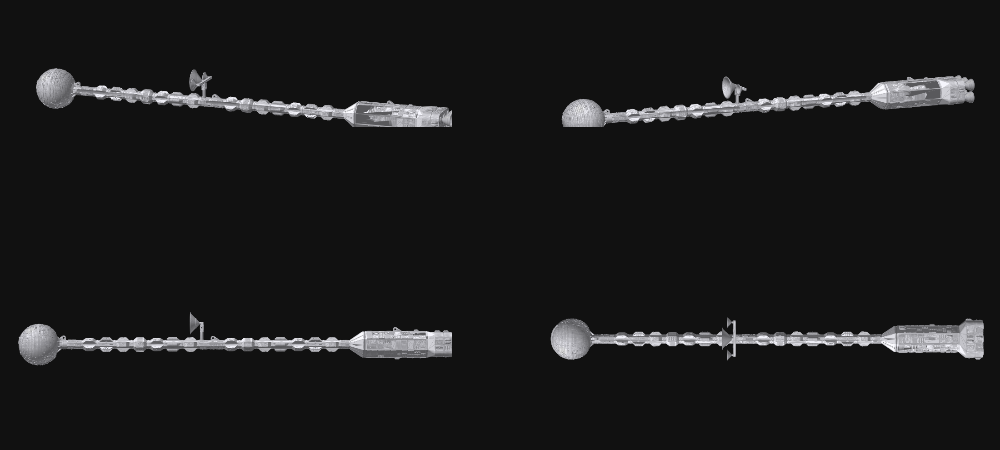
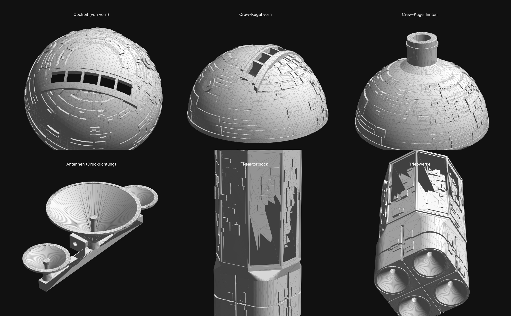
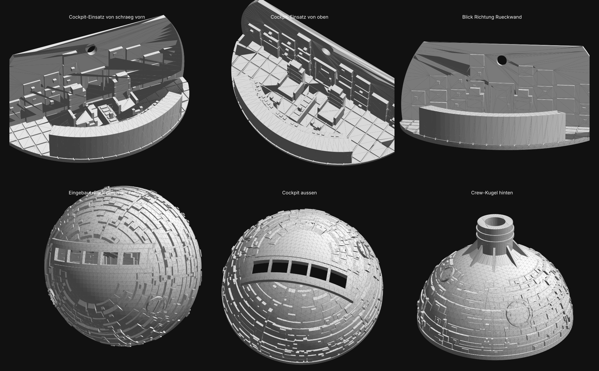
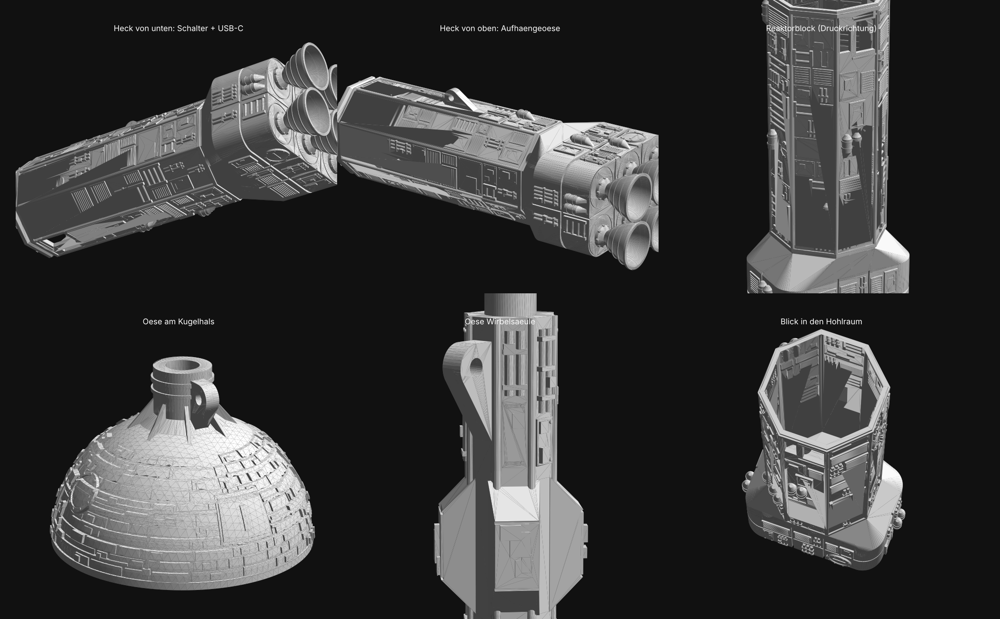

# Raumschiff-Modell mit LED-Beleuchtung (eigenes Design)

Eigenes Hard-SF-Raumschiff im Stil der klassischen "Wirbelsäulen"-Schiffe: kugelförmiges Crew-Modul mit Cockpit vorn,
lange Wirbelsäule mit Tankmodulen, bewegliche Antenne, Reaktorblock mit sechs Glockendüsen. Keine Kopie eines Filmmodells.
Das Modell wird **frei hängend** montiert; Akku, Elektronik und Schalter sitzen komplett im Schiff.









- Gesamtlänge 788 mm, Kugel 72 mm, größtes Einzelteil 260 mm hoch (für Anycubic Kobra Plus, 300 × 300 × 350 mm)
- Alle Teile liegen bereits in Druckausrichtung und brauchen **keine Stützstrukturen**
- `generate.py` erzeugt alle Dateien neu (`pip install manifold3d numpy`); Maße stehen oben im Skript

## Teile (Ordner `stl/`)

| Datei | Teil | Hinweis |
|---|---|---|
| 01_crew_front | Crew-Kugel vordere Hälfte, Cockpit mit 5 Fenstern nach vorn | Öffnung nach unten |
| 02_crew_rear | Crew-Kugel hintere Hälfte mit Hals und **Aufhängeöse** | Öffnung nach unten |
| 03_crew_joiner_ring | Verbindungsring | in die hintere Hälfte kleben |
| 04_spine_front_antenna | Wirbelsäule vorn (252 mm), Loch für den Antennenmast am hinteren Ende | stehend, **Brim 10 mm**, max. 25 mm/s |
| 05_spine_rear | Wirbelsäule hinten (252 mm) mit **Aufhängeöse** am vorderen Ende | stehend, **Brim 10 mm**, max. 25 mm/s |
| 06_antenna_dishes | Träger mit 1 großen und 2 kleinen Schüsseln, LED-Sitze und Kabelnut | Schüsseln öffnen nach oben, langsam drucken |
| 07_antenna_mast | Mast mit Gabel und Kabelkanal | kopfüber (Gabel unten), Brim 5 mm |
| 08_adapter_collar | Übergang Wirbelsäule → Block | breite Seite unten; **nur stecken, nicht kleben** (Zugang zum Akku) |
| 09_engine_block | Reaktorblock (153 mm) mit Akku-/Elektronikraum, Ausschnitten für Schalter und USB-C, **Aufhängeöse**, 6 Düsensockeln | Heckfläche nach unten |
| 10_engine_nozzle_6x | Glockendüse (Ø 22 mm, Wand 0,8 mm) | **6× drucken**, Rand unten, langsam; Zapfen ins Heck kleben |
| 11_cockpit_interior | Cockpit-Einsatz: Deck, 2 Sitze, Instrumentenpult, Mittelkonsole, Rückwand | Deck nach unten; 0,08 mm Schichthöhe |
| 00_assembly_preview_only | Nur Vorschau | **nicht drucken** |

## Aufhängung

Drei Ösen (Loch Ø 3,2 mm) sitzen auf der Oberseite, gemessen von der Schiffsspitze:

| Öse | Position | Teil |
|---|---|---|
| vorn | 82 mm | Hals der Crew-Kugel (02) |
| Mitte | 346 mm | Wirbelsäule hinten (05), 20 mm hinter der Antenne |
| hinten | 670 mm | Reaktorblock (09), über dem Akku |

- Vorn und hinten tragen das Gewicht; die mittlere Öse verhindert Durchhängen und sollte nur leicht gespannt sein.
- Die Ösen sind so gedruckt, dass der Zug **in** den Druckschichten liegt, nicht quer dazu.
- Empfohlen: Nylonschnur 0,4–0,5 mm oder dünnes Stahlseil, an drei Deckenhaken. Schnurlängen so einstellen, dass das Schiff waagerecht hängt.
- **Pflicht für die Steifigkeit:** Steckverbindungen von Kugel, Wirbelsäule und Übergang mit 2K- oder Sekundenkleber verkleben und einen
  **2-mm-Stahldraht oder Carbonstab (ca. 520 mm)** durch den Kabelkanal der Wirbelsäule schieben; die Leitungen passen daneben.
- Die Teile unter Last sind PLA mit 4 Wandlinien. Vor dem Aufhängen jede Öse von Hand mit etwa 1 kg Zug prüfen.

## Cockpit einbauen

1. Einsatz (11) vor dem Verkleben bemalen, z. B. Sitze dunkel, Bildschirme farbig.
2. Warmweiße LED von hinten in das Loch über der Tür stecken (Ø 3,2 mm), sie leuchtet nach vorn ins Cockpit.
3. Einsatz von der offenen Seite in die vordere Kugelhälfte (01) schieben, bis das Pult vorn unter den Fenstern anliegt, und mit wenigen Tropfen Kleber fixieren.
4. Erst danach den Verbindungsring (03) einsetzen; er wird in die hintere Hälfte (02) geklebt.
5. Fenster vorher von innen mit klarer Folie hinterkleben.

## Antenne (beweglich)

- Die Schüsseln zeigen nach vorn. Der Träger kippt um ca. ±40° auf einem Scharnier, der Mast dreht sich im Loch der Wirbelsäule.
- Scharnierstift: ein 12 mm langes Stück **1,75-mm-Filament** durch Gabel und Träger schieben (sitzt in der Gabel stramm, im Träger locker).
- Mast nur einstecken, nicht kleben, wenn er drehbar bleiben soll.

## Oberflächendetails

Alle Details sind aus einem Baukasten erzeugt und so ausgelegt, dass sie ohne Stützen drucken (max. ca. 1,3 mm Überstand, größere Teile mit 45°-Anlauf):
Rohrbündel mit Schellen und Ventilen, versenkte Kanäle mit innenliegender Leitung, runde Schleusen mit Rahmen, Schrauben, Griff und Scharnier,
rechteckige Türen mit Fenster, Lüftungsgitter, genietete Wartungsplatten, Drucktanks mit Spannbändern, Hüllenplatten und Leitungen auf der Kugel,
Radiatorrippen und ein Schleusenmodul an der Wirbelsäule.

## Druckeinstellungen (0,2-mm-Düse)

- Schichthöhe 0,08 mm für Crew-Kugel, Cockpit, Reaktorblock und Antenne, sonst 0,10 mm; Linienbreite 0,22 mm
- 4 Wandlinien, 15 % Füllung, PLA weiß oder hellgrau
- Geschwindigkeit Außenwand max. 40 mm/s, stehende Wirbelsäulenteile 25 mm/s
- Im Slicer "dünne Wände erkennen" einschalten; Stützen aus; Brim wie in der Tabelle
- Beim vorderen Kugelteil die Naht (Z-Seam) nach hinten legen, die Fensterstege sind 1,2 mm breite Brücken

## Beleuchtung und Stromversorgung

**10 LEDs, 1 × 18650-Akku im Reaktorblock, Schalter und USB-C-Ladebuchse auf der Unterseite des Blocks.**

### Einkaufsliste

| Anzahl | Teil | Wofür | Hinweis |
|---|---|---|---|
| 1 | 18650 Li-Ion-Zelle, 2500–3500 mAh, Markenware | Energie | Zelle muss in den Halter passen |
| 1 | Akkuhalter 1 × 18650 mit Litzen, max. 79 × 21 × 21,5 mm | hält die Zelle | |
| 1 | TP4056-Lademodul **mit Schutzschaltung** (DW01), USB-C, ca. 28 × 17 mm | Laden + Tiefentlade-/Kurzschlussschutz | Anschlüsse B+/B− und OUT+/OUT− |
| 1 | MT3608 Step-up-Modul (36 × 17 mm) | macht aus 3–4,2 V stabile 5 V | **vor dem Anschließen der LEDs auf 5,0 V einstellen** |
| 1 | Mini-Wippschalter KCD11, 2-polig, Einbauausschnitt 13,5 × 9 mm | Ein/Aus | rastet von außen in die Blockunterseite |
| 6 | LED 3 mm kaltweiß oder blau, klar | Triebwerke | |
| 1 | LED 3 mm warmweiß, diffus | Cockpit | |
| 3 | SMD-LED 0402, vorverdrahtet mit Kupferlackdraht, **50 cm**, **ohne** eingebauten Widerstand (3-V-Typ) | Antennenschüsseln | Sets mit Widerstand für 9–18 V sind bei 5 V zu dunkel |
| 6 / 1 / 3 | Widerstand 150 Ω / 220 Ω / 330 Ω, 0,25 W | Triebwerke / Cockpit / Antennen | je LED einer |
| 1 | Stück Lochrasterplatine ca. 30 × 15 mm | Verteiler | |
| 2 m | Litze 0,14 mm², rot und schwarz | Verbindungen | |
| 1 | Multimeter | 5 V einstellen, Polung prüfen | unverzichtbar |
| – | Schrumpfschlauch 1,5 mm, Lötkolben, Heißkleber, doppelseitiges Klebeband | | |

### Schaltung

```
18650 im Halter ──► TP4056 (B+ / B−)
                    TP4056 OUT+ ──► Schalter ──► MT3608 IN+
                    TP4056 OUT− ───────────────► MT3608 IN−
                                                 MT3608 OUT+ (5,0 V) ──► 5-V-Schiene ┐ Verteilerplatine
                                                 MT3608 OUT− (GND)  ──► GND-Schiene ┘ im Reaktorblock
   5 V ──150 Ω──►|── GND   (6 ×, Triebwerke)
   5 V ──220 Ω──►|── GND   (1 ×, Cockpit; zwei Litzen durch die Wirbelsäule nach vorn)
   5 V ──330 Ω──►|── GND   (3 ×, Antennen; Lackdrähte durch Mast und Wirbelsäule nach hinten)
```

Alle LEDs liegen parallel, jede mit eigenem Widerstand. Geschätzter Verbrauch: ca. 100 mA bei 5 V, rund 170 mA aus dem Akku,
grob 12–18 Stunden Leuchtdauer pro Ladung (Schätzung, nicht gemessen).

### Anordnung im Reaktorblock (Hohlraum 42 mm breit, 108 mm lang, von vorn zugänglich)

Von hinten (Triebwerke) nach vorn (Übergangsstück):

1. **6 mm Kabelraum** direkt über den Triebwerkskanälen, hier sitzt auch die Verteilerplatine (hochkant).
2. **Akkuhalter** (79 mm) oben an der Decke des Hohlraums, mit Klebeband fixiert. Darunter liegt der **MT3608** auf dem Boden.
3. **Elektronikraum** (16 mm) ganz vorn: der **Schalter** rastet von außen in den Ausschnitt auf der Unterseite; das **TP4056** steht hochkant
   daneben, seine USB-C-Buchse zeigt nach unten in den zweiten Ausschnitt (5 × 11 mm). Mit Heißkleber fixieren.

Mit den Maßen aus der Einkaufsliste passen alle vier Teile rechnerisch kollisionsfrei hinein; zwischen Akkuhalter und Hohlraumecken bleibt aber kein Spiel.
Akkuwechsel: Übergangsstück (08) abziehen, Halter nach vorn herausziehen. Normalerweise wird nur über USB-C geladen.

### Leitungswege

- **Triebwerke:** sechs LEDs von innen in die Sitze stecken; die Kanäle der vier äußeren Düsen laufen schräg.
- **Cockpit:** zwei Litzen vom Block durch Übergangsstück und Wirbelsäule (Kanal Ø 4,5 mm) in die Kugel, LED in das Loch über der Cockpittür.
- **Antennen:** jede Schüssel hat in der Mitte einen Sitz für eine 0402-LED mit Bohrung (Ø 0,9 mm) nach hinten. Die Lackdrähte laufen in der Nut
  auf der Rückseite des Trägers zur Mitte, mit einer **lockeren Schlaufe** (ca. 15 mm) über das Scharnier, durch den Mast (Ø 1,3 mm) und das Loch
  in der Wirbelsäule in den Hauptkanal und nach hinten in den Block. Bohrungen nach dem Druck mit einem 0,8–1-mm-Bohrer freimachen.
- **Reihenfolge:** erst alle Leitungen einziehen und am Verteiler testen, dann kleben.

### Sicherheit

- MT3608 **ohne angeschlossene LEDs** mit dem Multimeter auf 5,0 V drehen. Unverstellt kann er weit mehr liefern und zerstört dann sofort alle LEDs.
- Nur ein Lademodul **mit** Schutzschaltung verwenden und die Zelle richtig herum einlegen. Li-Ion-Zellen nie kurzschließen.
- **Der Akku lädt in einem geschlossenen PLA-Gehäuse an der Decke.** Nur unter Aufsicht laden, mit maximal 1 A, und das Schiff danach vom Kabel trennen.
- Manche dieser Lademodule laden nicht an einem USB-C-zu-USB-C-Kabel. Dann ein USB-A-zu-USB-C-Kabel nehmen.
- Die Ausschnitte beruhen auf Händlerangaben, die um 1–3 mm schwanken. **Teile zuerst kaufen und nachmessen**, dann Teil 09 drucken;
  die Maße stehen als `SWITCH_CUT`, `USB_CUT` und `BLOCK_L` oben im Skript.
